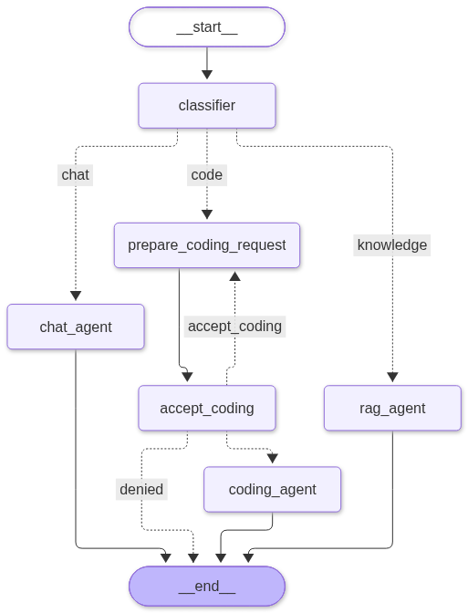

# LangGraph assistant for climate notes and code edits

Ask a question about greenhouse gas emissions, continue a conversation, or request a change to a project file from the same terminal. This Python application uses LangGraph to route each message to one of three workflows. Ollama runs the language and embedding models, and Aider handles approved coding requests.

## Try the three routes

| Example prompt | Expected route | What happens |
| --- | --- | --- |
| `Hi! Can you help me brainstorm a project name?` | Chat | The assistant uses the conversation history to reply. |
| `What do my notes say about Scope 2 emissions?` | Knowledge | The assistant retrieves three of five built-in climate passages. It is instructed to quote the shortest passage that answers the question or reply “I don't know.” |
| `Create a file called hello.py that prints Hello.` | Code | The assistant rewrites the request and shows the proposed instruction. Enter `y` to let Aider edit the project, `n` to cancel, or a revision to see a new proposal. |

The five passages in [main.py](./main.py) cover emissions scopes, science-based targets, net zero, ISO 14064 and operational emissions reductions. Edit the `KNOWLEDGE` list and restart the application to try your own material.



## Run locally or in GitHub Codespaces

Use a Bash terminal in the repository root. Python 3.11 or 3.12 is a suitable starting point. Install [Ollama](https://ollama.com/download) in the environment that will run the script. For Codespaces, that means installing and starting Ollama inside the Codespace.

**1. Start Ollama and download the models.** If the service is already running, skip the first command. Otherwise leave it running in a separate terminal.

```bash
ollama serve
```

In your project terminal, run:

```bash
ollama pull llama3.2:1b
ollama pull all-minilm
ollama pull qwen2.5-coder:1.5b
```

The first model classifies requests and generates replies. The second indexes the climate passages at startup. Aider uses the third to edit code.

**2. Install the Python dependencies and Aider.**

```bash
python3 -m venv .venv
source .venv/bin/activate
python -m pip install langgraph langchain-core langchain-ollama pydantic python-dotenv numpy
python -m pip install aider-install
aider-install
aider --version
```

The coding workflow launches `aider` as a terminal command. If the version check fails, follow the installer's instructions to add its executable directory to your shell's PATH. [Aider installation guide](https://aider.chat/docs/install.html)

**3. Start the assistant.**

```bash
python main.py
```

At `Enter message:`, try one of the prompts above. Each completed turn prints the classified intent and the reply. Press Ctrl+C to exit.

## Implementation notes

- **Session memory.** LangGraph checkpoints messages and pending approvals in memory. Each launch starts a new conversation.
- **Code edits.** Approval applies to the displayed instruction. Aider runs in the project directory with automatic confirmation and Git integration disabled. To inspect its edits afterwards, run `git status` and `git diff`.
- **Diagram rendering.** Startup regenerates `graph.png` before the first prompt. If rendering fails on a restricted network, the existing diagram is available above. To run the assistant without regenerating it, comment out the `draw_mermaid_png(...)` line in `main.py`.
- **Earlier experiments.** [Archive/](./Archive/) contains an earlier chatbot and routing prototype, plus small scripts for trying retrieval prompts and embeddings.
